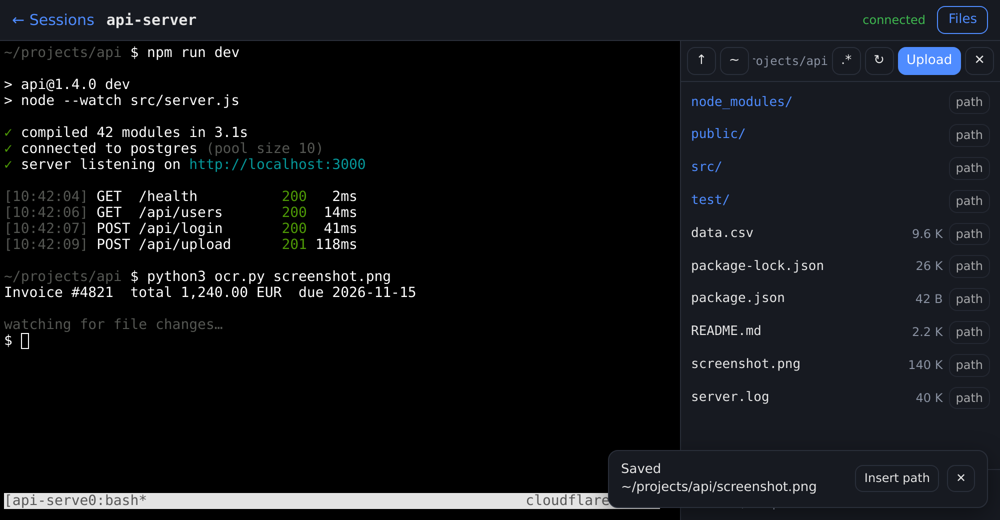

<h1 align="center">cloudflare-tmux</h1>

<p align="center">
  <b>Your tmux sessions, in any browser.</b><br>
  Served through a <b>Cloudflare Tunnel</b> and protected by <b>Cloudflare Access</b>.
</p>

<p align="center">
  <a href="https://syan-dev.github.io/cloudflare-tmux/"><b>📖 Documentation</b></a> ·
  <a href="https://syan-dev.github.io/cloudflare-tmux/quickstart.html">Quickstart</a> ·
  <a href="https://syan-dev.github.io/cloudflare-tmux/security.html">Security model</a>
</p>

<p align="center">
  <a href="https://github.com/syan-dev/cloudflare-tmux/actions/workflows/ci.yml"></a>
  <a href="LICENSE"></a>
</p>

---

<p align="center">
  
  
</p>
<p align="center">
  
</p>

## What you get

- **A terminal in any browser**, on your laptop or your phone.
- **No open ports.** Your server connects out to Cloudflare. It works behind NAT and CGNAT.
- **Sign in with your Cloudflare account.** Only the people you list get in.
- **Sessions keep running** when you close the tab. It's real tmux, so `tmux attach` works on the server too.
- **Files too.** Browse folders, download, drag files in, or paste a screenshot into the terminal.
- **One command to set up.** `./install.sh` does the Cloudflare side and installs the services.

## How it works

Your browser opens `https://term.example.com`. Cloudflare shows its login page first and lets only listed people through.
The request then travels through a tunnel to your server, where a small Node.js app attaches you to a tmux session.

## Install

You need a domain on Cloudflare, [Zero Trust](https://one.dash.cloudflare.com/) turned on, and a Linux server
with systemd, tmux and Node.js 18 or newer. All on free plans.
Details: [Before you start](https://syan-dev.github.io/cloudflare-tmux/prerequisites.html).

```bash
git clone https://github.com/syan-dev/cloudflare-tmux.git
cd cloudflare-tmux
./install.sh
```

The installer asks three questions: your **hostname**, **who may log in** as `you@example.com:youruser`, and a
**Cloudflare API token** used only during setup
([how to create it](https://syan-dev.github.io/cloudflare-tmux/cloudflare/api-token.html#create-it)).
Then open `https://term.example.com` and sign in with your Cloudflare account.

Step by step, with every dashboard click written out:
[Install](https://syan-dev.github.io/cloudflare-tmux/quickstart.html).

## Day to day

```bash
cloudflare-tmux status                       # is it online?
cloudflare-tmux add carol@example.com carol  # let someone log in (invite them as a member first)
cloudflare-tmux people                       # who may log in, and when they last did
cloudflare-tmux doctor                       # something wrong? it tells you the fix
```

## Documentation

Full docs: **https://syan-dev.github.io/cloudflare-tmux/**

| Start here | |
|---|---|
| [Before you start](https://syan-dev.github.io/cloudflare-tmux/prerequisites.html) | the three things you need |
| [Install](https://syan-dev.github.io/cloudflare-tmux/quickstart.html) | five minutes, one command |
| [Add a person](https://syan-dev.github.io/cloudflare-tmux/add-a-person.html) | let someone else log in |
| [Using it](https://syan-dev.github.io/cloudflare-tmux/usage.html) | the dashboard, the terminal, files, your phone |
| [Troubleshooting](https://syan-dev.github.io/cloudflare-tmux/troubleshooting.html) | `cloudflare-tmux doctor`, errors and fixes |

Reference: [maintenance](https://syan-dev.github.io/cloudflare-tmux/operations.html),
[settings](https://syan-dev.github.io/cloudflare-tmux/configuration.html),
[security model](https://syan-dev.github.io/cloudflare-tmux/security.html),
[two-step code](https://syan-dev.github.io/cloudflare-tmux/two-step.html),
[what gets created on Cloudflare](https://syan-dev.github.io/cloudflare-tmux/cloudflare/what-gets-created.html),
[multi-user install](https://syan-dev.github.io/cloudflare-tmux/install/multi-user.html).

## Development

```bash
npm install
AUTH_DISABLED=1 node server.js   # http://127.0.0.1:7681, no Cloudflare needed
npm test
```

See [CONTRIBUTING.md](CONTRIBUTING.md). Security issues: [SECURITY.md](SECURITY.md).

## License

[MIT](LICENSE). Not affiliated with or endorsed by Cloudflare, Inc.
