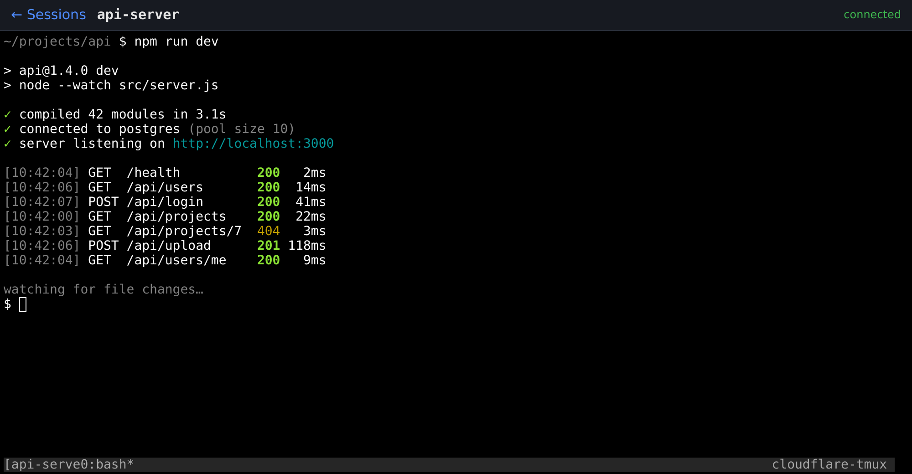
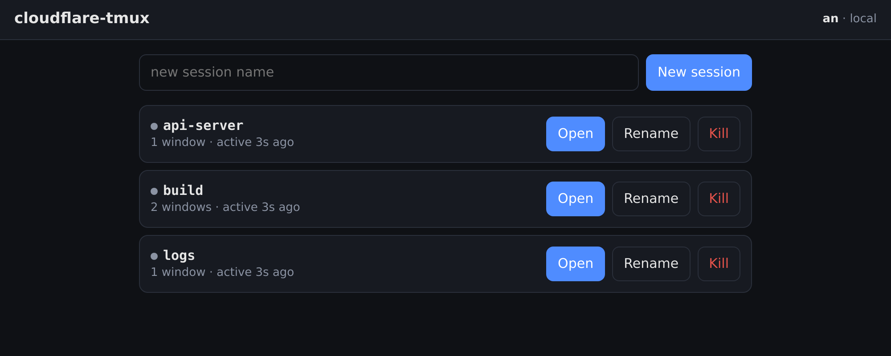

<h1 align="center">cloudflare-tmux</h1>

<p align="center">
  <b>Your tmux sessions, in any browser.</b><br>
  Served through a <b>Cloudflare Tunnel</b> and protected by <b>Cloudflare Access</b>.
</p>

<p align="center">
  <a href="https://syan-dev.github.io/cloudflare-tmux/"><b>📖 Documentation</b></a> ·
  <a href="https://syan-dev.github.io/cloudflare-tmux/quickstart.html">Quickstart</a> ·
  <a href="https://syan-dev.github.io/cloudflare-tmux/security.html">Security model</a>
</p>

<p align="center">
  <a href="https://github.com/syan-dev/cloudflare-tmux/actions/workflows/ci.yml"></a>
  <a href="LICENSE"></a>
</p>

---

<p align="center">
  
  
</p>

## What you get

- **A terminal in any browser**, on your laptop or your phone.
- **No open ports.** Your server connects out to Cloudflare. It works behind NAT and CGNAT.
- **Sign in with your Cloudflare account.** Only the people you list get in.
- **Sessions keep running** when you close the tab. It's real tmux, so `tmux attach` works on the server too.
- **One command to set up.** `./install.sh` does the Cloudflare side and installs the services.

## How it works

Your browser opens `https://term.example.com`. Cloudflare shows its login page first and lets only listed people through.
The request then travels through a tunnel to your server, where a small Node.js app attaches you to a tmux session.

## Install

You need a domain on Cloudflare, [Zero Trust](https://one.dash.cloudflare.com/) turned on (the free plan is fine),
and a Linux server with systemd, tmux and Node.js 18 or newer.
Details: [Prerequisites](https://syan-dev.github.io/cloudflare-tmux/prerequisites.html).

```bash
git clone https://github.com/syan-dev/cloudflare-tmux.git
cd cloudflare-tmux
./install.sh
```

The installer asks three questions:

- **Hostname**, for example `term.example.com`.
- **Who may log in.** Start with yourself: `you@example.com:youruser`, your Cloudflare email and your Linux user.
- **A Cloudflare API token**, used only during setup. [How to create it](https://syan-dev.github.io/cloudflare-tmux/cloudflare/api-token.html#create-it).

Open `https://term.example.com` and sign in with your Cloudflare account.

Afterwards, [delete the API token](https://syan-dev.github.io/cloudflare-tmux/cloudflare/api-token.html#delete-it-afterwards)
and go through the [security checklist](https://syan-dev.github.io/cloudflare-tmux/security.html#hardening-checklist).
To let more people in, invite them as members of your Cloudflare account and run one command:

```bash
./install.sh add carol@example.com carol
```

See [Add a person](https://syan-dev.github.io/cloudflare-tmux/add-a-person.html).

Without prompts, for scripts:

```bash
CF_API_TOKEN=... ./install.sh --yes --host term.example.com --identities you@example.com:$USER
```

If someone gets a Linux user other than yours, the installer asks once and runs the app as a root service
so it can start a shell as that user. See [Multi-user install](https://syan-dev.github.io/cloudflare-tmux/install/multi-user.html).

## Documentation

Full docs: **https://syan-dev.github.io/cloudflare-tmux/**

| | |
|---|---|
| [Prerequisites](https://syan-dev.github.io/cloudflare-tmux/prerequisites.html) | what you need first |
| [Quickstart](https://syan-dev.github.io/cloudflare-tmux/quickstart.html) | install in five minutes |
| [Add a person](https://syan-dev.github.io/cloudflare-tmux/add-a-person.html) | let someone else log in |
| [Cloudflare login](https://syan-dev.github.io/cloudflare-tmux/cloudflare/cloudflare-login.html) | how the login method works |
| [API token](https://syan-dev.github.io/cloudflare-tmux/cloudflare/api-token.html) | permissions, when you need it |
| [What gets created](https://syan-dev.github.io/cloudflare-tmux/cloudflare/what-gets-created.html) | every Cloudflare object |
| [Configuration](https://syan-dev.github.io/cloudflare-tmux/configuration.html) | variables, flags, files |
| [Security model](https://syan-dev.github.io/cloudflare-tmux/security.html) | layers and hardening |
| [Two-step code](https://syan-dev.github.io/cloudflare-tmux/two-step.html) | optional authenticator code |
| [Operations](https://syan-dev.github.io/cloudflare-tmux/operations.html) | logs, updates, uninstall |
| [Troubleshooting](https://syan-dev.github.io/cloudflare-tmux/troubleshooting.html) | `./install.sh doctor`, errors and fixes |

## Development

```bash
npm install
AUTH_DISABLED=1 node server.js   # http://127.0.0.1:7681, no Cloudflare needed
npm test
```

See [CONTRIBUTING.md](CONTRIBUTING.md). Security issues: [SECURITY.md](SECURITY.md).

## License

[MIT](LICENSE). Not affiliated with or endorsed by Cloudflare, Inc.
